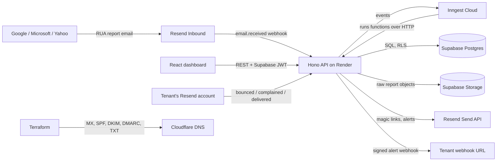
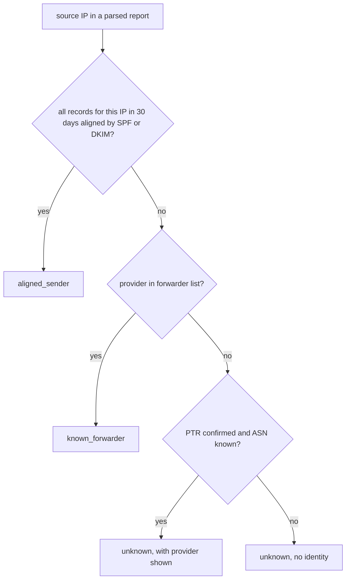
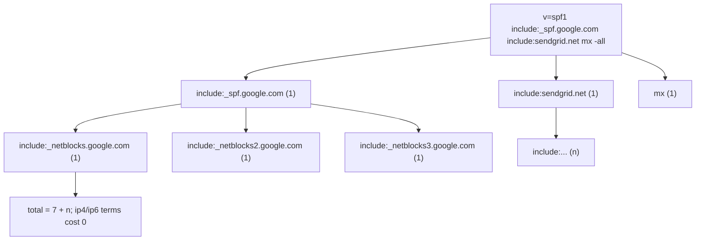

# Rua

Rua receives DMARC aggregate reports for a tenant's domains, classifies every sending source, tells the tenant when a new or spoofing source appears, and says when the domain is safe to move to `p=quarantine` or `p=reject`. Tenants who send through Resend can connect their Resend webhooks so bounce and complaint rates sit next to the DMARC data. The name is the DMARC tag that makes reports flow: `rua=`.

This is a side project for one operator with a handful of tenants. Every hosted dependency runs on a free tier. The design is multi-tenant end to end because that is the part worth showing.

## Problem

A domain owner publishes `v=DMARC1; p=none; rua=mailto:...` and receives a gzipped XML file from Google, Microsoft and Yahoo every day. Nobody reads them. The owner never learns that a marketing vendor sends unaligned mail, that a forwarder breaks SPF, or that someone in another country sends mail as their domain. They never move past `p=none` because they cannot tell what would break. Commercial tools fix this at a monthly price that makes no sense for a personal domain or a small company.

## Solution

Rua gives each domain a unique report address. Resend receives the mail and calls a webhook. The API stores the raw report and emits an Inngest event. Inngest functions parse the report, enrich every source IP, classify it, raise alerts, and run a daily audit of the domain's DNS records. A React dashboard shows sources, alignment over time, alerts, bounce and complaint rates, and a policy recommendation with the exact record to publish.



Inngest Cloud calls back into the same Render web service, so the worker is the web process. Render's free tier spins the service down after fifteen minutes idle; Resend and Inngest both retry, so a cold start delays a report by about thirty seconds and loses nothing.

## Goals

- A tenant signs in with a magic link, adds a domain, proves ownership with a TXT record, and sees reports within 48 hours of publishing the RUA address.
- Every source IP in every report is classified as aligned sender, known forwarder, or unknown, with PTR, ASN and provider shown.
- A tenant is told, by email and optionally by signed webhook, the first time a new source or a spoofing source appears.
- The dashboard states whether the domain is ready for `p=quarantine` or `p=reject` and shows the record to publish.
- A daily audit grades SPF, DMARC, DKIM, MTA-STS, TLS-RPT and BIMI and keeps a history of findings.
- Tenant data is isolated by Postgres row-level security, proven by tests.
- Reports are treated as hostile input: size, decompression, XML entity and time limits are enforced and tested.
- `@rua/dmarc-parser` is a standalone package with a fixture corpus.

## Non-goals

- Forensic (RUF) reports. Few reporters send them and they carry message content.
- Organizations, teams, roles. One Supabase user is one account.
- Sending mail on behalf of tenants. Rua sends only its own magic links and alerts.
- Billing, plans, quotas beyond a per-account domain cap.
- Running an MTA. Resend receives the mail.
- Paid infrastructure. Every component has a free tier that covers the expected volume.

## Decisions

| Area | Decision | Why |
| --- | --- | --- |
| Runtime | TypeScript, Node 22, pnpm workspace | Fastest path for the author; diffmap links symbols natively |
| Packages | `@rua/api` (Hono), `@rua/web` (React + Vite), `@rua/dmarc-parser` | Explicit handlers, publishable parser |
| Hosting | Render free web service, auto-deploy from `main` | Free; one process serves API, SPA and Inngest functions |
| Database | Supabase Postgres via Drizzle ORM | Free; RLS; one vendor with auth and storage |
| Auth | Supabase Auth magic link, SMTP through Resend | No password storage, near-zero auth code |
| Tenant | account = Supabase user; `account_id` on every tenant table | Simplest RLS predicate |
| RLS | role `rua_app` without BYPASSRLS; `SET LOCAL app.account_id` per transaction | Independent of Supabase client libraries, testable |
| Jobs | Inngest functions served at `/api/inngest` | Durable steps, retries, cron, free tier, no worker dyno |
| Inbound mail | Resend Inbound to `d-<random>@reports.<yourdomain>` | No MTA; one address per domain, routed by local part |
| Outbound mail | Resend Send API | Magic links and alerts |
| Webhook verification | Resend SDK `webhooks.verify` (wraps svix) | Needed for inbound and tenant hooks; no Svix account |
| Outbound alert webhooks | Own HMAC-SHA256 signature, retried by Inngest | Small, explainable, no third party |
| Raw reports | Supabase Storage, 30-day lifecycle; parsed rows kept | Replay after parser fixes without filling 500 MB |
| Dedup | unique `(domain_id, reporter_org, report_id)` | RFC 7489 report IDs are unique per reporter |
| Enrichment | PTR + forward confirm + bundled ASN dataset + curated provider map, cached 30 days | Works offline in tests, no API key |
| Secrets at rest | AES-256-GCM, key from env, per-row IV, `key_id` column | Tenant Resend signing secrets and webhook secrets |
| DNS as code | Terraform, Cloudflare provider, DNS only | The records this project is about; Render and Supabase stay manual |
| Logging | winston JSON to stdout; Render logs; Inngest dashboard | No APM vendor |
| Tests | Vitest; parser fixtures; integration against `supabase start` with RLS isolation tests | The isolation claim must be proven |
| CI | GitHub Actions: lint, typecheck, test, migration check, `terraform plan` | Gates `main` |
| Frontend | Recharts, Tailwind, shadcn/ui | Fast, presentable charts |

## Data model

Every tenant-owned table carries `account_id`. The RLS policy is the same on each.

```sql
create table accounts (
  id uuid primary key,                 -- = auth.users.id
  created_at timestamptz not null default now()
);

create table domains (
  id uuid primary key default gen_random_uuid(),
  account_id uuid not null references accounts(id),
  name text not null,                  -- example.com, lowercased, IDNA
  rua_local_part text not null unique, -- d-7f3k9a2mq4xz
  verify_token text not null,          -- value of TXT _rua.example.com
  verified_at timestamptz,
  last_verified_at timestamptz,
  created_at timestamptz not null default now(),
  unique (account_id, name)
);

create table reports (
  id uuid primary key default gen_random_uuid(),
  account_id uuid not null references accounts(id),
  domain_id uuid not null references domains(id),
  reporter_org text not null,          -- google.com
  report_id text not null,             -- reporter's id
  begin_at timestamptz not null,
  end_at timestamptz not null,
  policy_published jsonb not null,     -- {p, sp, pct, adkim, aspf}
  raw_object_key text,                 -- null after lifecycle delete
  received_at timestamptz not null default now(),
  unique (domain_id, reporter_org, report_id)
);

create table report_records (
  id bigint generated always as identity primary key,
  account_id uuid not null references accounts(id),
  report_id uuid not null references reports(id) on delete cascade,
  source_ip inet not null,
  count int not null,
  disposition text not null,           -- none | quarantine | reject
  dkim_aligned boolean not null,
  spf_aligned boolean not null,
  header_from text not null,
  envelope_from text,
  auth_results jsonb not null          -- [{type: dkim|spf, domain, selector?, result}]
);

create table ip_intel (                -- global cache, no account_id
  ip inet primary key,
  ptr text,
  ptr_confirmed boolean not null default false,
  asn int,
  as_name text,
  provider text,                       -- from the curated provider map, nullable
  refreshed_at timestamptz not null
);

create table domain_sources (
  account_id uuid not null references accounts(id),
  domain_id uuid not null references domains(id),
  source_ip inet not null,
  classification text not null,        -- aligned_sender | known_forwarder | unknown
  first_seen timestamptz not null,
  last_seen timestamptz not null,
  primary key (domain_id, source_ip)
);

create table alerts (
  id uuid primary key default gen_random_uuid(),
  account_id uuid not null references accounts(id),
  domain_id uuid not null references domains(id),
  kind text not null,                  -- new_source | spoofing_source | policy_ready
  payload jsonb not null,
  created_at timestamptz not null default now(),
  emailed_at timestamptz,
  webhook_delivered_at timestamptz
);

create table alert_webhooks (
  account_id uuid primary key references accounts(id),
  url text not null,
  secret_enc bytea not null,
  key_id text not null
);

create table resend_connections (
  id uuid primary key default gen_random_uuid(),
  account_id uuid not null references accounts(id),
  domain_id uuid not null references domains(id),
  signing_secret_enc bytea not null,
  key_id text not null,
  created_at timestamptz not null default now()
);

create table delivery_stats (
  account_id uuid not null references accounts(id),
  domain_id uuid not null references domains(id),
  day date not null,
  delivered int not null default 0,
  bounced int not null default 0,
  complained int not null default 0,
  primary key (domain_id, day)
);

create table record_snapshots (
  id uuid primary key default gen_random_uuid(),
  account_id uuid not null references accounts(id),
  domain_id uuid not null references domains(id),
  taken_at timestamptz not null default now(),
  records jsonb not null,              -- {spf, dmarc, dkim: {selector: txt}, mta_sts, tls_rpt, bimi}
  findings jsonb not null              -- [{code, severity, message, fix}]
);
```

```sql {4-5}
alter table domains enable row level security;
alter table domains force row level security;

create policy tenant_isolation on domains
  using (account_id = current_setting('app.account_id', true)::uuid);
-- [!note L4-L5] The same policy, with the same predicate, is created on every table that has account_id. ip_intel has none and is readable by both roles.
```

Two database roles:

| Role | Used by | RLS | Purpose |
| --- | --- | --- | --- |
| `rua_app` | request handlers | enforced; `SET LOCAL app.account_id` per transaction | everything a signed-in tenant does |
| `rua_worker` | Inngest functions | bypassed by a role-scoped policy | ingest resolves a domain by local part before it knows the tenant |

## Threat model

Reports come from the whole internet and anyone can send mail to a report address. The table lists what Rua trusts and what it does about the rest.

| Threat | Control | Where |
| --- | --- | --- |
| Forged inbound webhook | Resend signature verified with the inbound signing secret; reject on failure | Phase 2 |
| Report for a domain the sender does not own | Reports are routed by the unguessable local part, never by the domain named inside the report | Phase 2 |
| Tenant claims a domain they do not control | TXT `_rua.<domain>` must hold the account's token before any data is shown; re-checked weekly | Phase 1, 5 |
| Zip bomb or oversized attachment | 5 MB attachment cap; streaming decompression stops at 50 MB; one `.xml` member per zip; nested archives rejected | Phase 2 |
| XML external entities, billion laughs | `processEntities: false`, no DTD processing, depth cap | Phase 2 |
| Runaway parse | Inngest step timeout 30 s; failure after 3 retries lands in the Inngest dead-letter view | Phase 2 |
| Cross-tenant read | RLS on every tenant table; `rua_app` cannot bypass; integration test proves tenant A sees none of tenant B | Phase 1 |
| Tenant secrets at rest | AES-256-GCM with per-row IV; key from env; `key_id` for rotation | Phase 4 |
| Forged tenant Resend event | Verified with that tenant's own signing secret | Phase 4 |
| Alert webhook target abuse (SSRF) | URL must be https, public IP, no redirects followed; resolved once and pinned for the request | Phase 4 |
| Replay of a report delivery | Unique `(domain_id, reporter_org, report_id)`; parser upserts | Phase 2 |
| Enrichment lookups as a side channel | PTR and ASN lookups run from the worker with a per-IP cache; no tenant-controlled hostnames are resolved except the tenant's own verified domain | Phase 3, 5 |

## Phases

### Phase 1: Scaffold, sign-in, tenant isolation, domain verification

**Today**

Nothing exists. The repo holds package manifests and this spec.

**Proposed**

A visitor enters an email address and receives a magic link from `login@<yourdomain>`. After clicking it they land on an empty dashboard, add `example.com`, and see two things to publish: a TXT record at `_rua.example.com` with a token, and a DMARC `rua=` address `d-7f3k9a2mq4xz@reports.<yourdomain>`. They press **Verify**, the API resolves the TXT record, and the domain turns green. Until then the domain shows no data.

```ts
// what the client sees
POST /api/domains { name: "example.com" }
// 201 { id, name, verified: false,
//       txt: { host: "_rua.example.com", value: "rua-verify=Q0x…" },
//       rua: "d-7f3k9a2mq4xz@reports.<yourdomain>" }

POST /api/domains/:id/verify
// 200 { verified: true, verifiedAt } | 409 { error: "txt_not_found", observed: [...] }
```

The workspace takes shape in this phase. `@rua/api` serves three things from one Hono app: the REST API under `/api`, the Inngest handler at `/api/inngest`, and the built SPA from `packages/web/dist` for every other path. `@rua/web` holds the React app and uses `supabase-js` only for sign-in; every data call goes to `/api` with the Supabase access token as a bearer.

```services
service Browser "React dashboard"
  state session = none
  state domain = none
service API "Hono on Render"
  > Verifies the Supabase JWT, opens a transaction as rua_app, sets app.account_id, runs the handler.
  service Auth
    > requireAccount middleware: verifies the JWT with the Supabase JWKS and puts account_id on the context.
  service Domains
    > Domain handlers and the DNS verifier.
service Supabase
  service SupabaseAuth "Supabase Auth"
    > Issues magic links through Resend SMTP and JWTs.
  service Postgres
    state domains = 0 rows
service DNS "Public DNS"
  > Resolved with Node's dns.promises against the system resolver.

start "A tenant adds and verifies a domain"
  > Supabase Auth signs the tenant in. The API creates the domain under RLS, hands back the TXT token and report address, and later verifies the TXT record before showing any data.

step "Tenant requests a magic link"
  Browser -> SupabaseAuth: signInWithOtp(email)
    > supabase-js, directly from the browser. Supabase sends the mail through Resend SMTP.
step "Tenant clicks the link and holds a session"
  SupabaseAuth -> Browser: access_token
  Browser.session = jwt
step "Tenant adds example.com"
  Browser -> API: POST /api/domains
    > Authorization: Bearer <jwt>
  API -> Auth: requireAccount(jwt)
  API -> Domains: createDomain(account, name)
step "The handler writes inside a tenant transaction"
  Domains -> Postgres: SET LOCAL app.account_id; INSERT domains
    > withTenant opens the transaction, sets the GUC, runs the handler, commits.
  Postgres.domains = 1 row
  API -> Browser: 201 txt + rua address
  Browser.domain = unverified
step "Tenant publishes the TXT record and presses Verify"
  Browser -> API: POST /api/domains/:id/verify
  Domains -> DNS: TXT _rua.example.com
step "DNS answers and the domain turns green"
  DNS -> Domains: rua-verify=Q0x…
  Domains -> Postgres: UPDATE domains SET verified_at
  API -> Browser: 200 verified
  Browser.domain = verified
```

Every request handler runs inside one helper that binds the tenant to the transaction. There is no code path that queries a tenant table outside it.

```ts {5-6}
export async function withTenant<T>(accountId: string, fn: (tx: Tx) => Promise<T>) {
  return db.transaction(async (tx) => {
    // SET LOCAL does not accept bind parameters, so the value is
    // passed through set_config, which does.
    await tx.execute(sql`select set_config('app.account_id', ${accountId}, true)`);
    return fn(tx);
  });
}
// [!note L5-L6] The third argument `true` scopes the setting to the transaction. A pooled connection never leaks a tenant into the next request.
// [!note withTenant] Handlers receive `tx`, never the root `db`. The root `db` connects as rua_app, which has no BYPASSRLS, so a forgotten set_config returns zero rows rather than everyone's rows.
```

Verification resolves the TXT record and compares every string against the stored token in constant time.

```callstack [Verify a domain]
 response = verifyDomain(ctx)
 ├── domain = tx.select(domains).where(id)  # RLS limits this to the caller's account
 ├── answers = dns.resolveTxt(`_rua.${domain.name}`)  # ENOTFOUND and ENODATA become []
 ├── found = answers.some(a => timingSafeEqual(join(a), `rua-verify=${domain.verifyToken}`))
 ├── if !found: return 409 txt_not_found with observed answers
 ├── tx.update(domains).set({ verifiedAt: now(), lastVerifiedAt: now() })
 └── return 200
```

The isolation test is the acceptance test for this phase. It creates two accounts, inserts a domain for each through `withTenant`, then reads as each account and as a raw `rua_app` connection with no GUC set.

```ts
test("tenant A cannot read tenant B", async () => {
  await withTenant(a, (tx) => tx.insert(domains).values({ accountId: a, name: "a.test", ... }));
  await withTenant(b, (tx) => tx.insert(domains).values({ accountId: b, name: "b.test", ... }));
  expect(await withTenant(a, (tx) => tx.select().from(domains))).toHaveLength(1);
  expect(await db.select().from(domains)).toHaveLength(0); // no GUC, no rows
});
```

Terraform lands here too, because the magic-link sender domain needs SPF and DKIM before Supabase Auth can send anything. `infra/dns` holds one Cloudflare zone's records as variables and resources: the Resend sending records for `<yourdomain>`, the MX for `reports.<yourdomain>` pointing at Resend's inbound host, a DMARC record for `<yourdomain>` whose `rua=` is Rua's own first domain, and the `_rua.<yourdomain>` TXT for that domain. The values for Resend's records come from the Resend dashboard and are variables, not hardcoded.

```changes

```

### Phase 2: Receive, store and parse reports

**Today**

A report sent to `d-7f3k9a2mq4xz@reports.<yourdomain>` bounces. Resend has nowhere to deliver it.

**Proposed**

Google sends a report. Within a minute the dashboard's Reports tab lists it: reporter, period, message count, and a row per source IP with disposition and SPF and DKIM alignment. Sending the same report twice changes nothing.

```ts
GET /api/domains/:id/reports?from=2026-11-01
// 200 { reports: [{ id, reporterOrg: "google.com", reportId: "1234…",
//        beginAt, endAt, messages: 412, policyPublished: { p: "none", pct: 100 } }] }

GET /api/reports/:id/records
// 200 { records: [{ sourceIp: "209.85.220.41", count: 400, disposition: "none",
//        dkimAligned: true, spfAligned: true, headerFrom: "example.com" }] }
```

The webhook handler does as little as possible: verify, store, emit. Everything that can fail slowly runs in an Inngest function with retries.

```services
service Reporter "google.com"
service ResendIn "Resend Inbound"
  > MX for reports.<yourdomain>. Keeps the message and its attachments for a retention window and calls the webhook.
service API "Hono on Render"
  service InboundHook "POST /hooks/resend/inbound"
    > Verifies the signature, stores the payload, emits an event. Responds in under a second.
  service ParseFn "Inngest: report/received"
    > Served at /api/inngest. Downloads, decompresses, parses, upserts. Three retries with backoff.
service Inngest "Inngest Cloud"
  state queued = 0
service Storage "Supabase Storage"
  state raw = 0 objects
service Postgres
  state reports = 0
  state records = 0

start "One report becomes rows"
  > Resend calls the webhook. The handler verifies it, saves the payload, and emits report/received. Inngest runs the parse function, which fetches the attachment, decompresses it under limits, parses the XML, and upserts the report and its records.

step "Google delivers the report"
  Reporter -> ResendIn: SMTP to d-7f3k9a2mq4xz@reports.<yourdomain>
step "Resend calls the inbound webhook"
  ResendIn -> InboundHook: POST email.received
    > Headers svix-id, svix-timestamp, svix-signature.
step "The handler verifies and resolves the domain"
  InboundHook -> Postgres: SELECT domains WHERE rua_local_part = 'd-7f3k9a2mq4xz'
    > Runs as rua_worker. An unknown local part returns 200 and increments a dropped counter; no error reaches the sender.
step "The handler emits and returns"
  InboundHook -> Inngest: report/received { emailId, domainId, accountId }
  Inngest.queued = 1
  InboundHook -> ResendIn: 200
step "Inngest runs the parse function"
  Inngest -> ParseFn: report/received
  Inngest.queued = 0
step "The function fetches the attachment and stores it raw"
  ParseFn -> ResendIn: GET attachment
    > Through the Resend API with the email id from the event.
  ParseFn -> Storage: PUT reports/<domainId>/<emailId>.gz
  Storage.raw = 1 objects
step "The function decompresses and parses under limits"
  ParseFn -> ParseFn: decompress + parseAggregateReport
    > The parser package. Byte counter aborts past 50 MB; entities are off.
step "The function upserts the report"
  ParseFn -> Postgres: INSERT reports ON CONFLICT DO NOTHING; INSERT records
    > One transaction. A conflict on (domain_id, reporter_org, report_id) ends the run as a no-op.
  Postgres.reports = 1
  Postgres.records = 3
step "The function emits report/parsed for Phase 3"
  ParseFn -> Inngest: report/parsed { reportId, domainId, accountId }
```

The parse function is the part a reviewer should read closely, so here it is as a stack.

```callstack [Parse one report]
 result = parseReport(event, step)
 ├── payload = step.run("fetch", fetchAttachment(event.emailId))  # Resend API; rejects > 5 MB by Content-Length and by counting
 ├── key = step.run("store", putRaw(event.domainId, event.emailId, payload))
 ├── xml = step.run("decompress", decompress(payload))  # gzip or zip; 50 MB cap; one .xml member
 ├── report = step.run("parse", parseAggregateReport(xml))  # @rua/dmarc-parser
 ├── inserted = step.run("upsert", upsertReport(event, report, key))
 │   ├── tx.insert(reports).onConflictDoNothing().returning(id)
 │   ├── if none: return { duplicate: true }
 │   └── tx.insert(report_records).values(report.records.map(toRow))
 ├── if inserted.duplicate: return
 └── step.sendEvent("report/parsed", { reportId, domainId, accountId })
```

The parser package has one entry point and no I/O. It returns a normalized object or throws a typed error; the caller decides what to do with either.

```ts
export type AggregateReport = {
  reporter: { orgName: string; email: string; reportId: string };
  dateRange: { begin: Date; end: Date };
  policyPublished: { domain: string; p: Policy; sp?: Policy; pct: number; adkim: "r" | "s"; aspf: "r" | "s" };
  records: Array<{
    sourceIp: string;
    count: number;
    disposition: Policy;
    dkim: "pass" | "fail";   // policy_evaluated
    spf: "pass" | "fail";
    headerFrom: string;
    envelopeFrom?: string;
    authResults: Array<{ type: "dkim" | "spf"; domain: string; selector?: string; result: string }>;
  }>;
};

export function parseAggregateReport(xml: string | Uint8Array): AggregateReport;
export function decompress(bytes: Uint8Array, limits?: Limits): Uint8Array;
export class ReportError extends Error { code: "too_large" | "nested_archive" | "not_xml" | "schema" }
```

Limits live in one object and the fixture corpus exercises each one.

| Limit | Value | Fixture |
| --- | --- | --- |
| Attachment size | 5 MB | `fixtures/oversized.gz` (6 MB of zeros) |
| Decompressed size | 50 MB | `fixtures/bomb.gz` (10 KB → 1 GB) |
| Zip members | exactly one `.xml`, no directories | `fixtures/nested.zip` |
| XML entities | disabled, no DTD | `fixtures/xxe.xml`, `fixtures/laughs.xml` |
| Parse time | 30 s Inngest step timeout | timed test on `fixtures/wide.xml` |

Real reports from Google, Microsoft, Yahoo, Amazon SES and Fastmail sit next to them. The parser is published from this package later; nothing in it imports from `@rua/api`.

```changes

```

### Phase 3: Enrich, classify, and show the sources

**Today**

The Reports tab lists raw IPs. The tenant cannot tell Google Workspace from a stranger's VPS.

**Proposed**

The Sources tab lists every IP that has ever sent mail as the domain, grouped by provider, with PTR, ASN, message volume for 30 days, and a label: **Aligned sender**, **Known forwarder**, or **Unknown**. A chart shows daily volume split by label and a second one shows alignment rate over time. An **Unknown** source that fails both SPF and DKIM is highlighted; that is the spoofing signal Phase 4 alerts on.

```ts
GET /api/domains/:id/sources?days=30
// 200 { sources: [{ ip: "209.85.220.41", ptr: "mail-sor-f41.google.com", ptrConfirmed: true,
//        asn: 15169, asName: "GOOGLE", provider: "Google Workspace",
//        classification: "aligned_sender", messages: 11204, aligned: 11204,
//        firstSeen, lastSeen }] }
```

Classification uses only data Rua can derive locally: the report's own alignment results, reverse DNS, and a bundled ASN table. No third-party API.



A known forwarder is a provider that re-sends mail with the original header From and breaks SPF by design, such as Google Groups, Microsoft 365 forwarding, or mailing-list software. The list is a YAML file in the repo keyed by ASN and PTR suffix, and it is small on purpose.

```callstack [Classify the sources of one report]
 classifySources(event, step)
 ├── ips = step.run("distinct", distinctSourceIps(event.reportId))
 ├── for ip of ips (step.run per ip, concurrency 5)
 │   ├── intel = ipIntel.get(ip)  # cache row younger than 30 days
 │   ├── if !intel
 │   │   ├── ptr = dns.reverse(ip)  # first PTR only, lowercased
 │   │   ├── confirmed = (dns.resolve4/6(ptr)).includes(ip)
 │   │   ├── { asn, asName } = asnTable.lookup(ip)  # bundled dataset, loaded once
 │   │   ├── provider = providers.match({ asn, ptr })  # curated YAML
 │   │   └── intel = ipIntel.upsert({ ip, ptr, confirmed, asn, asName, provider })
 │   ├── stats = alignmentStats(domainId, ip, 30 days)
 │   ├── label = classify(stats, intel)
 │   └── changed = domainSources.upsert({ domainId, ip, label, lastSeen })  # returns { isNew, previousLabel }
 └── step.sendEvent("sources/classified", { domainId, accountId, changes })
```

`domain_sources` is per domain because the same Google IP is an aligned sender for one tenant and a spoofing source for another. `ip_intel` is global because a PTR does not depend on who is asking.

The dashboard reads two aggregate endpoints for the charts, both computed in SQL with `date_trunc('day', begin_at)` over `report_records` joined to `domain_sources`. Recharts draws a stacked area for volume by label and a line for the aligned percentage.

```changes

```

### Phase 4: Alerts and tenant Resend webhooks

**Today**

A new source appears in the Sources tab. Nobody is told. Bounce and complaint rates live in the tenant's Resend dashboard, far from the DMARC view.

**Proposed**

The first time an IP sends as the domain, the tenant gets an email: provider, PTR, ASN, count, alignment, and a link to the source. If the source is **Unknown** and failed both checks, the subject says so. A tenant who sets a webhook URL in Settings also receives a JSON body with an `X-Rua-Signature` header. A tenant who sends with Resend pastes their webhook signing secret and points a Resend webhook at their Rua endpoint; delivered, bounced and complained counts then appear per day on the Overview tab next to DMARC volume.

```ts
POST /api/settings/alert-webhook { url: "https://ops.example.com/hooks/rua" }
// 201 { url, secret: "whsec_…" }   // shown once

POST /api/domains/:id/resend-connection { signingSecret: "whsec_…" }
// 201 { endpoint: "https://rua.<yourdomain>/hooks/resend/tenant/4b1c…" }
```

```services
service ClassifyFn "Inngest: sources/classified"
service AlertFn "Inngest: alert/raise"
  > One run per alert. Email step, then webhook step. Each step retries on its own.
service Postgres
  state alerts = 0
service ResendOut "Resend Send API"
service Tenant "Tenant systems"
  state inbox = 0
  state webhookReceived = 0

start "A new source raises one alert through two channels"
  > Classification finds a source never seen for this domain. The alert function stores the alert, sends the email, and if the tenant configured a webhook, signs and posts the body with retries.

step "Classification reports a new source"
  ClassifyFn -> AlertFn: alert/raise { kind: new_source, domainId, ip }
step "The alert is stored first"
  AlertFn -> Postgres: INSERT alerts
    > Idempotency key on the Inngest event is domainId + ip + kind + day, so a re-run of classification does not alert twice.
  Postgres.alerts = 1
step "Email goes out through Resend"
  AlertFn -> ResendOut: POST /emails
  ResendOut -> Tenant: alert email
  Tenant.inbox = 1
step "The webhook is signed and posted"
  AlertFn -> Tenant: POST url, X-Rua-Signature
    > t=<unix>,v1=<hex hmac sha256 of `${t}.${body}`>. Receiver rejects when |now - t| > 5 min.
  Tenant.webhookReceived = 1
step "Delivery timestamps are recorded"
  AlertFn -> Postgres: UPDATE alerts SET emailed_at, webhook_delivered_at
```

Signing is one function, and the receiver-side verifier ships in the README so a tenant can copy it.

```ts
export function signAlert(secret: string, body: string, now = Date.now()) {
  const t = Math.floor(now / 1000);
  const v1 = createHmac("sha256", secret).update(`${t}.${body}`).digest("hex");
  return `t=${t},v1=${v1}`;
}
// [!note signAlert] Timestamp in the signed payload stops replays. The secret is generated once, shown once, and stored encrypted.
```

The outbound webhook URL is validated when saved and again when posted: `https` only, hostname resolves to a public unicast address, no redirects followed, 5 s timeout. The resolved address is used for the connection so a DNS answer cannot change between check and use.

The tenant's Resend events arrive on a per-connection endpoint. The connection id in the path selects the signing secret; the secret verifies the body; the body's `data.from` domain must match the connected domain.

```callstack [Ingest one tenant Resend event]
 response = tenantResendHook(ctx)
 ├── conn = resendConnections.get(ctx.param.id)  # rua_worker; 404 if unknown
 ├── secret = decrypt(conn.signingSecretEnc, conn.keyId)
 ├── event = resend.webhooks.verify(rawBody, headers, secret)  # throws → 400
 ├── if !["email.delivered","email.bounced","email.complained"].includes(event.type): return 204
 ├── fromDomain = domainOf(event.data.from)
 ├── if fromDomain !== conn.domainName: return 204  # counted, not stored
 ├── deliveryStats.increment(conn.domainId, dayOf(event.created_at), event.type)
 │   └── INSERT ... ON CONFLICT (domain_id, day) DO UPDATE SET <col> = <col> + 1
 └── return 204
```

Encryption for both secrets is one small module.

```ts
export function encrypt(plain: string, keyId = CURRENT_KEY_ID): Uint8Array; // iv(12) || tag(16) || ciphertext
export function decrypt(blob: Uint8Array, keyId: string): string;
// [!note encrypt] AES-256-GCM via node:crypto. Keys come from RUA_KEK_<keyId> env vars. Rotation: add a new key, re-encrypt rows in a migration, remove the old env var.
```

```changes

```

### Phase 5: Policy readiness, record audit, daily cron

**Today**

The tenant sees sources and alerts but still has to decide by hand whether `p=reject` is safe, and nothing tells them their SPF record has eleven lookups.

**Proposed**

The Overview tab shows the current published policy, the policy Rua recommends, the share of 30-day volume that would survive each policy, and the record to copy. Below it, a Records card lists findings from this morning's audit with severity and a fix, and a history of when each finding appeared and cleared. Once a day Rua also re-checks the ownership TXT and marks a domain unverified if it disappears.

```ts
GET /api/domains/:id/readiness
// 200 { published: "none", recommended: "quarantine",
//        survival: { quarantine: 0.998, reject: 0.991 },
//        blockers: [{ ip: "45.33.12.9", classification: "unknown", messages: 93, lastSeen }],
//        record: "v=DMARC1; p=quarantine; pct=100; rua=mailto:d-7f3k9a2mq4xz@reports.<yourdomain>; adkim=r; aspf=r" }

GET /api/domains/:id/audit
// 200 { takenAt, findings: [{ code: "spf_lookup_limit", severity: "high",
//        message: "SPF needs 11 DNS lookups; receivers stop at 10 and treat the result as permerror.",
//        fix: "Remove or flatten one include. Current chain: include:_spf.google.com (4), include:sendgrid.net (3), ..." }] }
```

Readiness is a pure function of 30 days of classified volume. Thresholds are constants in one file.

```ts
export function readiness(volume: ClassifiedVolume): Readiness {
  const legit = volume.aligned + volume.knownForwarder;
  const survival = {
    quarantine: legit / volume.total,
    reject: legit / volume.total,            // same share; reject is gated harder below
  };
  const recentUnknownFail = volume.unknownFailing.some((s) => s.lastSeen > daysAgo(14));
  const recommended =
    survival.reject >= 0.995 && !recentUnknownFail ? "reject" :
    survival.quarantine >= 0.99 ? "quarantine" : "none";
  return { survival, recommended, blockers: volume.unknownFailing };
}
// [!note recentUnknownFail] An unknown source that fails both checks in the last two weeks blocks reject even at 99.9%. It is either spoofing to stop, or a legitimate sender to authenticate first.
```

The audit runs as one Inngest cron per day with one step per domain, so a slow resolver for one tenant does not delay another.

```callstack [Audit one domain]
 auditDomain(domainId, step)
 ├── txt = step.run("ownership", dns.resolveTxt(`_rua.${name}`))  # mismatch → verified_at = null, alert kind ownership_lost
 ├── spf = step.run("spf", auditSpf(name))
 │   ├── record = resolveTxt(name).find(startsWith "v=spf1")
 │   ├── lookups = countLookups(record, depth 0)  # recurse include:, a, mx, ptr, exists, redirect=; stop at 10
 │   └── findings: missing, multiple records, +all, ?all, lookups > 10, void lookups > 2
 ├── dmarc = step.run("dmarc", auditDmarc(name))
 │   └── findings: missing, syntax, p=none, pct<100, rua missing, rua not a Rua address, sp missing with subdomains seen, adkim/aspf strict with relaxed-only senders
 ├── dkim = step.run("dkim", auditDkim(name, selectorsSeenInReports(domainId)))
 │   └── findings per selector: missing, CNAME to nowhere, key < 2048 bits, testing flag
 ├── extras = step.run("extras", auditExtras(name))  # _mta-sts TXT + policy fetch, _smtp._tls TXT, default._bimi
 ├── snapshot = recordSnapshots.insert({ domainId, records, findings })
 └── if newFindings(snapshot, previous).length: step.sendEvent("alert/raise", { kind: audit_finding })
```

SPF counting is the one piece of the auditor that is easy to get wrong, so the resolution is drawn out.



Every finding has a stable `code`, a severity, a message in plain words, and a fix the tenant can act on. Findings are compared by code and selector between snapshots so the history shows when each one appeared and cleared.

The same cron keeps the free Supabase project awake: a project with no activity for seven days pauses, and a daily read and write is activity.

```changes

```

## Running locally

```sh
pnpm install
supabase start                       # local Postgres, Auth, Storage
pnpm --filter @rua/api db:migrate    # drizzle-kit migrate against the local DB
npx inngest-cli@latest dev           # local Inngest dev server
pnpm dev                             # api on :3000, web on :5173
pnpm spec                            # this spec in the diffmap viewer
```

Inbound reports in development come from fixtures: `pnpm --filter @rua/api replay fixtures/google.xml.gz --domain <id>` posts a synthetic `email.received` event to the local hook with a valid signature.

## References

- RFC 7489, DMARC, section 7.2 aggregate report format and appendix C schema: https://www.rfc-editor.org/rfc/rfc7489
- RFC 7208, SPF, section 4.6.4 DNS lookup limits: https://www.rfc-editor.org/rfc/rfc7208#section-4.6.4
- RFC 8461 MTA-STS, RFC 8460 TLS-RPT
- Resend inbound email and webhooks: https://resend.com/docs
- Inngest serve handler for Hono and step functions: https://www.inngest.com/docs
- Supabase row-level security and `set_config`: https://supabase.com/docs/guides/database/postgres/row-level-security
- Drizzle ORM transactions: https://orm.drizzle.team/docs/transactions
- Render free web services: https://render.com/docs/free
- Terraform Cloudflare provider `cloudflare_dns_record`: https://registry.terraform.io/providers/cloudflare/cloudflare/latest/docs
